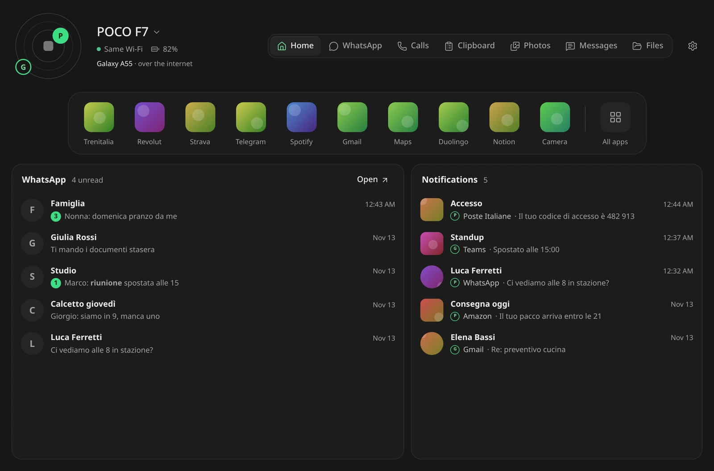

<p align="center"></p>

<h1 align="center">Orither</h1>

<p align="center">
  <a href="https://github.com/elpideus/orither/releases/latest"></a>
  <a href="https://github.com/elpideus/orither/actions/workflows/ci.yml"></a>
  <a href="LICENSE"></a>
</p>

Your phone, on your computer. Orither is an open source alternative to Phone
Link and KDE Connect: link an Android phone once, and its messages, photos,
files, apps, screen, microphone, speaker and camera are a click away, at home or
across the world.



## Download

| | |
| --- | --- |
| **Windows** 10 or 11 | [Orither-Setup-x64.exe](https://github.com/elpideus/orither/releases/latest/download/Orither-Setup-x64.exe) |
| **Linux**, any distribution | [Orither-x86_64.AppImage](https://github.com/elpideus/orither/releases/latest/download/Orither-x86_64.AppImage) |
| **Debian, Ubuntu** and derivatives | [orither_amd64.deb](https://github.com/elpideus/orither/releases/latest/download/orither_amd64.deb) |
| **Fedora, openSUSE** and derivatives | [orither.x86_64.rpm](https://github.com/elpideus/orither/releases/latest/download/orither.x86_64.rpm) |
| **Android** 10 or newer, 64-bit | Nothing to download: Orither on the computer installs it over USB. Or [Orither-android-arm64.apk](https://github.com/elpideus/orither/releases/latest/download/Orither-android-arm64.apk) |

These always reach the newest release. Every release, with its changes and
checksums, is on the [releases page](https://github.com/elpideus/orither/releases).

**Windows:** run the installer. It installs Orither for your account only, so it
needs no administrator rights. Windows SmartScreen may warn about an unknown
publisher, as the installer is not code-signed: choose **More info**, then
**Run anyway**.

**Linux:** make the AppImage executable and open it, or install the package:

```bash
chmod +x Orither-x86_64.AppImage && ./Orither-x86_64.AppImage
```

```bash
sudo apt install ./orither_amd64.deb
```

```bash
sudo dnf install ./orither.x86_64.rpm
```

**Android:** the easiest way is to let Orither on the computer install it, see
[Getting started](#getting-started). To install the APK yourself, open it on the
phone and allow installing it. Android asks once to allow apps from the browser
or file manager it was opened in, and Play Protect may offer to scan it first.

### Updates

Orither on the computer keeps itself up to date. It checks for a new version
shortly after it starts and every hour, downloads it in the background, and
installs it when you restart Orither, from the notice it shows, from
**Settings › Updates** or from the tray icon. If you never restart it, the
update installs by itself the next time Orither starts with the computer.
Every update is signed, and Orither installs only updates signed with its own
key. **Download updates automatically** in Settings turns the downloads off.

The .deb and .rpm packages update themselves too, when you restart Orither.
Installing asks for your password, as with any system package. The Android app
does not update itself yet: plug the phone in and use **Set up** again (it
installs the matching version), or install the new APK over the old one.

## What it does

| | |
| --- | --- |
| **Linking** | Scan a QR code or type a short code. The link survives restarts and changing networks. |
| **Messages** | Read SMS threads. One-time codes get a copy button, and pop up as they arrive. |
| **Several phones** | Link as many of your phones as you like. One is in focus, and the others are a click away on the orbit at the top of the window. Calls and notifications come in from all of them. |
| **WhatsApp** | WhatsApp Web, WhatsApp's own, as a page of Orither: every chat, to read, answer and send files. The home page shows the latest chats from the phone. |
| **Calls** | Answer, decline and make calls from the computer: phone calls, and WhatsApp, Telegram, Signal and other apps' calls. Once the phone is paired with the computer over Bluetooth, the call uses the computer's microphone and speakers or headphones. |
| **Gallery and files** | Browse the phone's photos and storage, and move files both ways. |
| **Clipboard** | Copy on one device, paste on the other. Text and files both work. |
| **Screen** | See and control the phone from a window, even with its screen off. |
| **Apps** | Every phone app is listed in Orither and opens with one click. |
| **Integrated Mode** | A phone app opens in a resizable window of its own, with its own icon and name, as if it were installed on the computer. |
| **Send to computer** | A Quick Settings button moves the app you're using on the phone to a window on the computer, where you left off. A tap sends it to the computer you used last, and a long press lets you choose. Closing the window gives it back to the phone. |
| **Notifications** | The phone's notifications show up on the computer. A click opens the app in a window of its own, on the page the notification leads to, as a tap on the phone would. WhatsApp's open the chat in Orither's WhatsApp page instead. Dismiss one on either device and it goes from both. |
| **Hardware** | The phone's speaker and microphone appear as audio devices on the computer, and its camera as a webcam. |
| **Trackpad and keyboard** | The phone becomes the computer's trackpad and keyboard: the keyboard stays up, and the space above it is the trackpad. |

## Getting started

1. [Install Orither](#download) on the computer and open it.
2. On the phone, turn on **USB debugging**: tap **Build number** seven times in
   **Settings › About phone**, then turn on USB debugging in **Developer
   options**.
3. Connect the phone with a USB cable, and allow the computer when the phone
   asks. Orither lists the phone under **Set up over USB**: click **Set up**.

Orither installs its app on the phone, links it, starts its helper there and
turns everything on, in about a minute. Nothing is downloaded on the phone, so
Android's restricted settings and Play Protect's checks on downloaded apps don't
get in the way. Orither carries Android's `adb` tool itself, so there is nothing
else to install, on Windows too.

Already have Orither on the phone? Open both, then scan the code the computer
shows, or type it in. Connect the phone with a USB cable once afterwards, so
that Orither can start its helper; in the app, **Turn everything on** then
allows everything at once.

The helper is the part of Orither that runs on the phone with the rights of
Android's debugging tools. Android only lets a computer start it, and the
screen, apps, messages, clipboard watching, microphone, camera and Bluetooth all
rely on it. It keeps running without the cable until the phone restarts.

After a restart, the computer starts the helper again over Wi-Fi, if **After
restarts** is allowed on the phone. It does this through Android's wireless
debugging, which Orither turns on for a few seconds and then off again. The
phone asks once on each Wi-Fi network: tap **Allow**, with **Always allow on
this network** ticked. The two devices do not need to share the network.
Android forgets a computer that has not used debugging for a week, so Orither
checks in every few days while they are linked.

Linking, WhatsApp, calls, the gallery, files and the speaker work without it.
So do notifications, though opening one in a window needs it.

### Play Protect and the Android app

Orither's Android app asks for no SMS access. Play Protect blocks any app from
outside Google Play that does, as harmful, and that is what blocked Orither
0.1.1 and earlier. From 0.2.0 the phone's helper reads the texts instead, so
Play Protect lets the app install. If Play Protect still asks, let it **Scan
app**, then install.

## How the devices reach each other

Orither picks the best way by itself, in this order:

| Route | When |
| --- | --- |
| **Local network** | Both devices are on the same network. The fastest by far. |
| **Bluetooth** | The devices are near each other and no network connects them. |
| **Internet** | A direct connection across the internet. |
| **Relay** | The last resort when no direct connection can be made. |

An internet path under 30 ms is preferred over Bluetooth, because Bluetooth
carries only about 0.5 Mbit/s. Everything is encrypted end to end on every route.
The relays are the public ones run by n0, the makers of
[iroh](https://www.iroh.computer). They cannot read the traffic, but they do see
that two devices are talking and from which addresses.

## Status

This is an early version. It has been tested on a Xiaomi POCO F7 on Android 16
with a Linux computer running KDE Plasma, and on an Android 16 emulator with
Linux and with a Windows 11 virtual machine.

**Windows** has nearly everything Linux has: setup over USB, the screen, apps in
windows of their own (each with its own taskbar button and a Start-menu
shortcut), messages, WhatsApp Web, notifications that open on a click and close
with the phone, the clipboard, photos, files, calls from the computer, the phone
as a trackpad and keyboard, and the system's light or dark mode and accent
colour. Not on Windows yet:

- the phone's speaker, microphone and camera as devices of the computer, which
  need signed virtual-device drivers that Orither does not have;
- calls through the computer's microphone and speakers, which rely on Linux's
  Bluetooth hands-free support;
- the Bluetooth route between the devices.

Windows asks once whether Orither may use the network: choose **Allow**, or the
devices can only reach each other through the relay.

**Known limits**

- **Phone restarts:** the helper only starts again when the phone is on Wi-Fi.
  Without Wi-Fi, or after a week apart, it needs the cable. So far this has been
  tried with a stopped helper, not yet with a real restart.
- **Local network route:** not yet tested on a real network, because the test
  router keeps Wi-Fi devices apart.
- **Bluetooth:** Linux only, and the phone's address is learned from the helper,
  so the helper must have run once. At 0.5 Mbit/s it suits messages and small
  files. The speaker's raw audio does not fit, and the screen drops to a low
  quality. After a link, the phone lists the computer among its Bluetooth devices
  until the next link.
- **WhatsApp:** WhatsApp Web is WhatsApp's own site, shown unchanged, and is
  linked like any WhatsApp Web, from **Linked devices** on the phone. Orither is
  not affiliated with WhatsApp. On Windows it keeps WhatsApp's own colours, since
  its browser engine takes no user style sheet. A click on the
  phone's notification finds the chat through WhatsApp Web's own notification for
  it, or by phone number, and otherwise opens on the chat list. The chats on the
  home board start when notification access is granted.
- **Notifications:** need the same notification access as WhatsApp. They have
  been tested with a stand-in notification server and a test app, not yet with
  Plasma's or GNOME's own. A click on one whose app has a window already opens it
  there, but does not bring the window to the front. On Windows, clearing one
  from the notification centre does not clear it on the phone (Windows only tells
  Store apps).
- **SMS:** read by the phone's helper, so they need it running. A new text
  reaches the computer when the phone's SMS app shows its notification, or within
  half a minute. RCS messages are not in Android's SMS store, so they do not show
  up.
- **Camera:** needs the `v4l2loopback` kernel module on Linux. The first time,
  **Set up** beside the camera asks for your password once and makes it load at
  every start, so there is no command to type. If another program, such as OBS,
  loaded the module first, the camera appears after the next restart. The phone's
  camera only turns on while a program uses the webcam,
  which needs `v4l2loopback` 0.13 or newer. With an older one, the phone's camera
  stays on the whole time the camera is switched on in Orither. The first time a
  phone is used, its picture can be cut or edged with black until the program
  starts the webcam again.
- **Calls:** the computer's microphone and speakers carry a call through
  Bluetooth, the way a car or a headset does, so the computer needs Bluetooth and
  is paired with the phone once. The other side of a video call still sees the
  phone's camera, not the computer's. Answering an app's call relies on its
  notification's buttons. Not yet tried with a real call.
- **Trackpad and keyboard:** Linux on Wayland or X11 through the desktop's remote
  control permission, which the computer asks for once. Typing uses the computer's
  keyboard layout, so characters it lacks are skipped. On Windows it works without
  asking, but cannot reach programs running as administrator.
- **Xiaomi phones:** HyperOS may stop Orither in the background unless **Autostart**
  is on. The app shows a shortcut to that setting on these phones.
- **Also untested:** scanning with the phone's camera (the QR code itself is tested
  with a separate decoder, and the link it holds pairs a phone), viewing a locked
  phone, and pasting copied files into a file manager.

## Requirements

**Phone:** Android 10 or newer, 64-bit ARM.

**Computer:** Windows 10 or 11, or 64-bit Linux with WebKitGTK 4.1 (Ubuntu
22.04, Fedora 36 or newer, and their peers). Orither carries Android's `adb`.
On Linux, the phone's speaker, microphone and camera need PulseAudio or PipeWire
(`pactl`), BlueZ, and `v4l2loopback`; the packages bring or recommend all but the
last. Some Windows computers need the phone maker's USB driver for USB debugging
(Samsung's, for example); most phones work without one.

## Building

The desktop app needs Rust, Node.js with pnpm, and the
[Tauri prerequisites](https://tauri.app/start/prerequisites/). Installing `nasm`
is optional and makes video decoding faster.

```bash
cd desktop
pnpm install
pnpm tauri dev
```

Installers land in `target/release/bundle`. They carry Android's `adb`, which a
script fetches first (pinned and checked):

```bash
node ../scripts/fetch-adb.mjs linux
```

```bash
pnpm tauri build --bundles deb,rpm,appimage --config src-tauri/adb.linux.conf.json
```

On Windows, `fetch-adb.mjs windows` and `--bundles nsis --config
src-tauri/adb.windows.conf.json` make the installer.

On rolling distributions, `linuxdeploy` can fail while stripping the AppImage's
libraries. Setting `NO_STRIP=true` for that command gets past it. The AppImage
carries GStreamer's plugins, for sound and video in WhatsApp Web, so the
machine that builds it needs them installed.

`pnpm dev` runs the UI alone in a browser, against a pretend phone.

The Android app also needs the Android SDK with NDK 30.0.16248370, and
[cargo-ndk](https://github.com/bbqsrc/cargo-ndk). Gradle builds the Rust side.

```bash
rustup target add aarch64-linux-android
```

```bash
cargo install cargo-ndk
```

```bash
cd android
./gradlew :app:assembleDebug
adb install -r app/build/outputs/apk/debug/app-debug.apk
```

Tests:

```bash
cargo test -p orither-link -p orither-viewer -p orither-desktop
```

```bash
cd desktop
pnpm exec tsc --noEmit
pnpm test
```

```bash
node --test "scripts/*.test.mjs"
```

## Releasing

Every push and pull request is checked on Linux, Windows and Android by
[CI](.github/workflows/ci.yml). A release is one command:

```bash
node scripts/release.mjs 0.2.0
```

It sets the version everywhere, commits, tags `v0.2.0` and pushes. GitHub
Actions then builds the Windows installer, the AppImage, the .deb, the .rpm and
the Android app, signs them, and publishes them as a release with the update
manifest installed copies read. [docs/releasing.md](docs/releasing.md) has the
details, pre-releases, and the signing keys.

## Project layout

```
crates/orither-link     The encrypted link: identity, pairing, routes, sessions
crates/orither-viewer   The window that decodes a phone screen and takes input
crates/orither-ffi      The link, as the Android app calls it
scripts                 Versions and releases, see docs/releasing.md
tools/testbed           An Android emulator, an isolated Linux session and a Windows VM, see docs/testing.md
desktop/src             The UI: React, with one folder per feature
desktop/src-tauri       The desktop app: Tauri, with one module per feature
android                 The Android app: Compose, with one package per feature
android/.../engine      The helper that runs on the phone as the shell user
```

[docs/architecture.md](docs/architecture.md) explains how it all fits together.

## Adding a feature

The link knows nothing about features, so a new one needs no change to it.
Everything is addressed by a feature name and a method.

**On the phone**, write a `Feature` and list it in `Features.install`
([Features.kt](android/app/src/main/java/dev/orither/feature/Features.kt)):

```kotlin
class Torch(private val context: Context) : Feature {
    override val id = "torch"

    override suspend fun call(method: String, body: JsonElement, peer: String): JsonElement =
        when (method) {
            "toggle" -> toggle()
            else -> super.call(method, body, peer)
        }
}
```

**In the UI**, add a folder that exports a `Feature` and list it in
[features/index.ts](desktop/src/features/index.ts). A feature with `tab: true`
gets a tab at the top and a page of its own:

```tsx
export const torch: Feature = { id: "torch", title: "Torch", icon: Flashlight, Page, tab: true };
```

`call("torch", "toggle")` reaches the phone in focus from any component, and
`useNotice("torch", "changed", handler)` hears from it. Pass a phone's id to
reach another one, and `{ everyPhone: true }` to hear from all of them.

**On the computer**, you only need Rust when the computer itself has to do
something. Write a `Feature` and list it in `Features::install`
([features/mod.rs](desktop/src-tauri/src/features/mod.rs)). Whatever it does not
handle passes straight through to the phone.

## Licence

Orither is free software, licensed under the
[GNU General Public License, version 3](LICENSE) or (at your option) any later
version. Version 0.1.0 was released under the Apache License 2.0, and stays
available under it.

Orither ships the scrcpy server (Apache License 2.0) and OpenH264 (BSD), see
[NOTICE](NOTICE).

OpenH264 is compiled from source here, so Cisco's patent licence, which covers
only the binaries Cisco itself publishes, does not extend to these builds. Check
what that means where you plan to distribute binaries.
